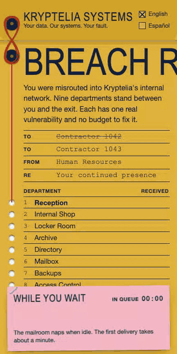
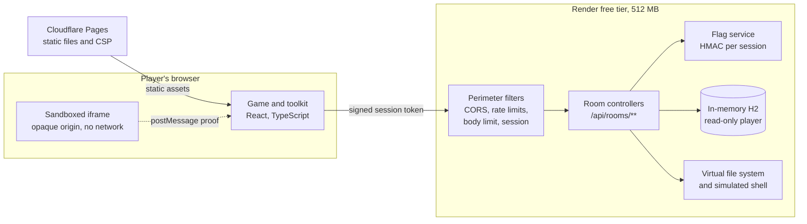

# Breach Room

**A web cybersecurity escape room you can play from your phone.**

You have been misrouted into the internal network of Kryptelia Systems, a fictional company that is ridiculous and therefore insecure. Nine departments stand between you and the exit. Each one holds a real vulnerability to exploit, and each exploit reveals a flag that opens the next door. After every room, a debrief shows what went wrong, the vulnerable and corrected Java side by side, the OWASP Top 10 category, and how you would catch it in a real system.

**[Play the live demo](https://breach-room.pages.dev)**. No account, no email, about ten minutes. The first visit can take up to a minute while the free-tier server wakes up, and the game makes that part of the story.

<p align="center">
  
</p>

## The departments

No spoilers, only the org chart.

| # | Department | What you are told |
| --- | ---------- | ------------------ |
| 1 | Reception | The receptionist left in 2019. The sign-in sheet stayed. |
| 2 | Internal Shop | Staff spend credits instead of receiving raises. |
| 3 | Locker Room | Lockers are assigned by a trust-based identity solution. |
| 4 | Archive | You may read your own file. The clerk assumes you would not lie. |
| 5 | Directory | An intern wrote it in one afternoon. It has never needed maintenance. |
| 6 | Mailbox | Webmail has one working feature. IT calls it personalization. |
| 7 | Backups | The key was moved somewhere safe, and someone wrote down where. |
| 8 | Access Control | Security wrote its own verifier after reading half a blog post. |
| 9 | Diagnostics | The last department. Please take your belongings. |

Everything is playable without DevTools. The built-in toolkit gives you a mini browser, a request repeater, a cookie jar, a decoder, and notes. The interface is available in English and Spanish.

## Architecture



The backend keeps no state between requests, because the free tier restarts it often. A session is a random 128-bit id plus its HMAC signature, verified on every request without storage. Each flag is an HMAC of the session and the room, so flags differ per player and cannot be copied from a walkthrough. Progress lives in the browser and survives blocked storage by falling back to memory.

## Safe by design

An intentionally vulnerable app on the public internet must never become a real entry point. **The vulnerabilities are real in their logic, but they only operate on simulated or tightly confined resources.** This is the part of the project I care about most.

| Room type | What stops it from being dangerous |
| --------- | ----------------------------------- |
| SQL injection | A private in-memory database, a `SELECT`-only account on two tables, passwords generated at startup and never stored, a two second timeout, a row cap, one statement at a time, a concurrency limit |
| Reflected XSS | A document served with a CSP sandbox and loaded in an iframe without `allow-same-origin`, so an injected script has an opaque origin and no network access, even if the page is opened directly |
| Path traversal | An in-memory map instead of a file system: there is no real file to reach |
| Command injection | An interpreter written in Java that knows six fake commands: no process is ever started |
| Forged tokens | Tokens grant access to one fictional door and nothing else |

**The rest of the app is not vulnerable.** Deliberately flawed code exists only inside `rooms/` and behind `/api/rooms/**`. Around it sit CORS for one origin, per-IP and per-session rate limits with a bounded key set, an 8 KB body limit that also catches chunked requests, security headers on every response, no bodies in logs, and a strict CSP on the frontend. There are no accounts and no personal data, and all room data is fake.

**Containment is tested, not assumed.**

- Every escape attempt from the database, such as reading files, defining functions, or changing data, must fail with a privilege error specifically. Merely failing is not enough: an earlier version of these tests passed while the account could not connect at all, and a control test now guards against that.
- A browser test confirms that an injected script runs and still cannot touch the game.
- A source scan fails the build if a forbidden API, such as process execution or deserialization, appears in the backend.
- The real server was attacked under production memory limits, which is why memory-heavy database functions are refused before they run.

## Tech stack

- **Backend:** Java 21, Spring Boot, `JdbcClient`, H2. No JPA or Spring Security, to start quickly in 512 MB. Startup takes about 12 seconds on 0.1 CPU, helped by a class data sharing archive built into the image.
- **Frontend:** React, Vite, and TypeScript, with no UI kit. Every room is a different form stock inside one visual system.
- **Tests:** JUnit 5 and MockMvc, Vitest, Playwright, and axe.
- **Hosting:** Cloudflare Pages and Render, both on free tiers. CI runs on GitHub Actions.

## Run it locally

You need Java 21, Maven, and Node 22.12 or newer.

Start the API:

```bash
cd backend
FLAG_SECRET=$(openssl rand -hex 32) SESSION_SECRET=$(openssl rand -hex 32) ALLOWED_ORIGIN=http://localhost:5173 mvn spring-boot:run
```

In a second terminal, start the game and open http://localhost:5173:

```bash
cd frontend
npm ci
VITE_API_ORIGIN=http://localhost:8080 npm run dev
```

The variables are listed in [`.env.example`](.env.example). The API refuses to start with short secrets or a wildcard origin.

## Tests

```bash
cd backend
mvn verify
```

```bash
cd frontend
npm test
```

The browser tests need the backend jar from `mvn verify`, and they start both servers on their own:

```bash
cd frontend
npx playwright install chromium
npm run test:e2e
```

## License

[MIT](LICENSE). Built by [Santiago Santofimio](https://santofimiodev.pages.dev). Kryptelia Systems is fictional, and any resemblance to your employer is a matter for your own conscience.
